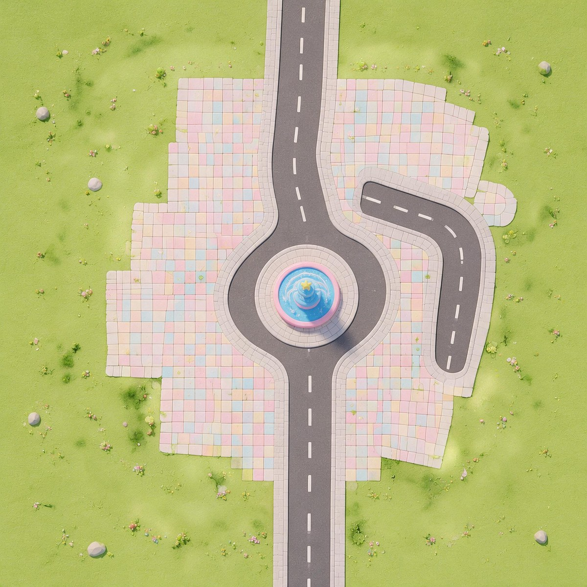

# DY-AI_TOWN

**造世界（AI World Creator）主世界地图工程：糖果童趣小镇**

一块 64 m × 64 m 的糖果色小镇地形：中央步行广场 + 喷泉环岛，一条主路南北贯穿。可直接导入「造世界编辑器」打开、编辑、二次发布。



---

## 三行装好

```bash
git clone https://github.com/MAChine110p/DY-AI_TOWN.git
cd DY-AI_TOWN
python tools/world.py install
```

关掉编辑器再重开，项目列表里就有 **糖果童趣小镇（主世界）**。

没有 Python 的成员，双击 `安装-Windows.bat`（Mac 用 `安装-Mac.command`）效果一样，但那是老脚本，uid 处理有 bug，见下方「已知问题」。

## 两种用法，选一种

| 你是谁 | 用哪条 | 结果 |
|-|-|-|
| 只是想打开看看 / 不熟悉 git | `python tools/world.py install` | 把工程**复制**到编辑器数据目录，仓库保持只读 |
| 要改图、要提交改动 | `python tools/world.py link` | **不复制**，把这份 clone 目录登记为工程；你在编辑器里的修改直接落在 git 工作区 |

改完提交：

```bash
git add -A && git commit -m "[asset] 调整南侧广场铺装"
git push
```

别人拉取后再同步到自己机器：

```bash
git pull
python tools/world.py sync      # 覆盖已登记的本机工程，保留 .creator/ 等运行时产物
```

## 常用命令

```bash
python tools/world.py verify                    # 校验所有文件哈希 + 仓库卫生
python tools/world.py verify --update-manifest  # 改完资产后刷新 项目清单.json
python tools/world.py install --dry-run         # 先看要做什么，不落盘
python tools/world.py sync --dest <工程路径>     # 手动指定同步目标
```

## 目录

```
projects/project_vqo1bvzh/   工程本体（唯一真理源）
├─ scene.data                地图：高度图 + 6 层 SplatMap + 2048 俯视图 + PCG 参数
├─ project.json              工程名与封面
├─ world-config.json         worldId / worldType
├─ settings/                 环境光等工程设置
└─ scripts/client/index.lua  场景脚本入口

tools/world.py               安装 / 登记 / 同步 / 校验
tools/install-windows.ps1    老的一键安装脚本（保留兼容）
地图信息.md                   地形与节点参数明细
地图提示词.md                 当初生成这张图的完整提示词，可复现
项目清单.json                 path + size + sha256 清单，CI 与本地校验都靠它
docs/                         工程文件说明、同步与协作规范
```

## 必须守的几条

- **`scene.data` 是二进制，冲突无法合并**。同一时间只能有一个人在编辑器里改这张图；两个人同时改，git 会给你 `CONFLICT (binary)`，只能取一方版本重新导出。
- **不要改 `scene.data` 内部的条目名**（`HeightMap_` / `SplatMap_` / `MatCoverTex_` 被按名字引用，改名即坏），不要重新打包。
- **不要提交** `projects.json`（含本机账号 uid）、`*.bak-*`、`.creator/`、`ai-*-config.json`、临时截图。`.gitignore` 已经挡住，别用 `--force` 绕过。
- 改动资产后必须跑 `python tools/world.py verify --update-manifest` 并一起提交，否则 CI 会红。

给 AI agent 的完整契约见 [AGENTS.md](AGENTS.md)；协作细节见 [docs/同步与协作规范.md](docs/同步与协作规范.md)。

## 已知问题

- **出生点在地形外**：`BornPoint` 在世界坐标 `(119.7, 80.0, 88.6)`，超出 64×64 地形块范围。预览时角色若悬空，把它拖到南端主街上，或调 `SerializePcgData.json` 里的 `respawnHeightY`（当前 `-50.0`）。
- **一处云端依赖**：场景音频引用 `hamlet-ugc/chengyunchuming_1.wav`（走 CDN，不在仓库里）。地形与贴图全部本地自足，缺的只是这段环境音。
- **老脚本的 uid bug**：`tools/install-windows.ps1` 在 `projects.json` 为空时会回退到打包者的 uid `3309980302973310`，导致工程登记的账号不是你。`tools/world.py` 已修正为从编辑器 `config.json` 的 `userinfo.uid` 读取，取不到就报错，绝不写死他人 uid。

## 来源与授权

- 地图数据（`scene.data`、`project.json`、`world-config.json`）来自原作者的造世界工程包，版权归原作者所有，本仓库仅作团队内部协作与二次编辑使用。
- 仓库的 `LICENSE`（Apache-2.0）只覆盖 `tools/`、`docs/` 与本文档等自行编写的代码和文字，**不代表**对地图资产重新授权。
- `world-config.json` 中原作者世界的快速预览二维码已移除；`worldId` 保留（编辑器识别世界类型需要）。
