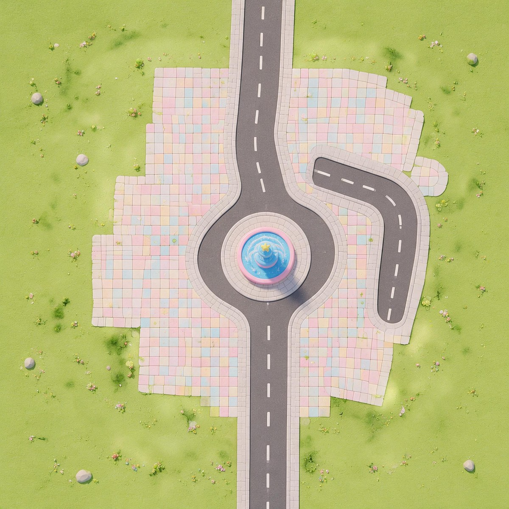

# 造世界｜主世界地图（糖果童趣小镇）

这是一个可以直接打开的**造世界编辑器工程**。下载解压后，双击一个脚本，工程就会出现在编辑器的项目列表里。



| 项 | 内容 |
|-|-|
| 工程名 | 糖果童趣小镇（主世界） |
| 工程目录 | `project_vqo1bvzh` |
| 地图数据 | `scene.data`（6.08 MB，高度图 + 6 层地表贴图 + 2048 俯视覆盖图） |
| 编辑器版本 | 1.0.92 |
| 打包时间 | 2026-11-02 |
| 依赖 | 无。模型与贴图全在本地，不依赖云端 GLB |

---

## 怎么打开（二选一）

### 方法 A：双击安装（推荐）

1. **先把造世界编辑器完全退出**（Mac 按 `Cmd+Q`；Windows 关掉所有窗口并在托盘退出）。
2. 解压压缩包，然后：
   - **Mac**：双击 `安装-Mac.command`
     第一次可能提示「无法打开，因为来自身份不明的开发者」→ 在文件上**右键 → 打开 → 打开**。
   - **Windows**：双击 `安装-Windows.bat`
3. 看到「🎉 安装完成」后，重新打开编辑器，项目列表里就有**糖果童趣小镇（主世界）**。

> 安装脚本只做两件事：把工程文件夹复制到编辑器目录、在 `projects.json` 里加一条记录。
> 动手前会自动备份你的 `projects.json`（`projects.json.bak-时间戳`），不会删你已有的项目。

### 方法 B：手动安装

1. 退出编辑器。
2. 把 `projects/project_vqo1bvzh` 整个文件夹复制到：
   - **Mac**：`~/Library/Application Support/AI World Creator/projects/`
   - **Windows**：`%APPDATA%\AI World Creator\projects\`
3. 用文本编辑器打开同目录的 `projects.json`，在 `[ ]` 里加一段（路径换成你自己的用户名）：

```json
{
  "projectPath": "/Users/你的用户名/Library/Application Support/AI World Creator/projects/project_vqo1bvzh",
  "latestOpenTime": 1793600000000,
  "latestEditTime": 1793600000000,
  "uid": "你原来那条记录里的 uid"
}
```

   Windows 写成 `C:\\Users\\你的用户名\\AppData\\Roaming\\AI World Creator\\projects\\project_vqo1bvzh`（注意双反斜杠）。
4. 保存，重新打开编辑器。

---

## 打开后你会看到什么

- 一块 **64 m × 64 m** 的地形底板（257 × 257 高度图，6 层地表材质），中间是糖果色步行广场和喷泉环岛，一条主路南北贯穿。
- 场景里共 6 个节点：`地图`、`Terrain`、`TerrainTile`、出生点 `BornPoint` 等。
- 出生点目前在世界坐标 **(119.7, 80.0, 88.6)**，可能在地形块外面 —— 如果预览时角色悬空或掉下去，把 `BornPoint` 拖到南端主街上（或改 `respawnHeightY`）即可。

## 包里都有什么

```
├── 安装-Mac.command          Mac 一键安装
├── 安装-Windows.bat          Windows 一键安装
├── 先读我-安装说明.md         本文件
├── 预览-俯视图.jpg            地图俯视预览（就是 MatCoverTex 那张）
├── 地图信息.md               工程/地形参数明细
├── 地图提示词.md             当初生成这张地图的完整提示词（想重跑可直接复制）
├── 项目清单.json             本次打包的校验信息（文件大小 + SHA-256）
├── projects/project_vqo1bvzh/  ← 工程本体
│   ├── scene.data            地图（ZIP：高度图/贴图/场景 JSON）
│   ├── project.json          工程名与封面
│   ├── world-config.json     worldId、世界类型、快速预览二维码
│   ├── settings/env-param-overrides.json  环境光设置
│   └── scripts/client/index.lua           场景脚本入口
└── tools/                    安装脚本用到的辅助文件
```

## 注意

- **先退出编辑器再安装**，否则内存里的旧项目列表可能把新记录覆盖掉。
- 别在编辑器开着的时候改 `scene.data`，保存时会被覆盖。
- 工程来自版本 1.0.92；对方编辑器版本差太多时，打开会提示「场景升级失败」，升级编辑器即可。
- `scene.data` 不要重命名里面的 `HeightMap_/SplatMap_` 条目名，`resourceRefs` 是按名字引用的。
